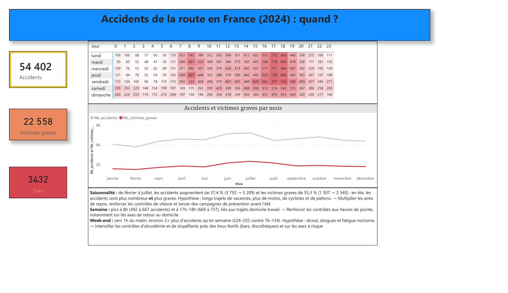
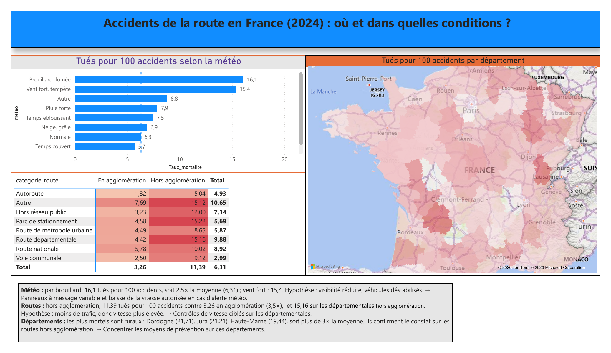
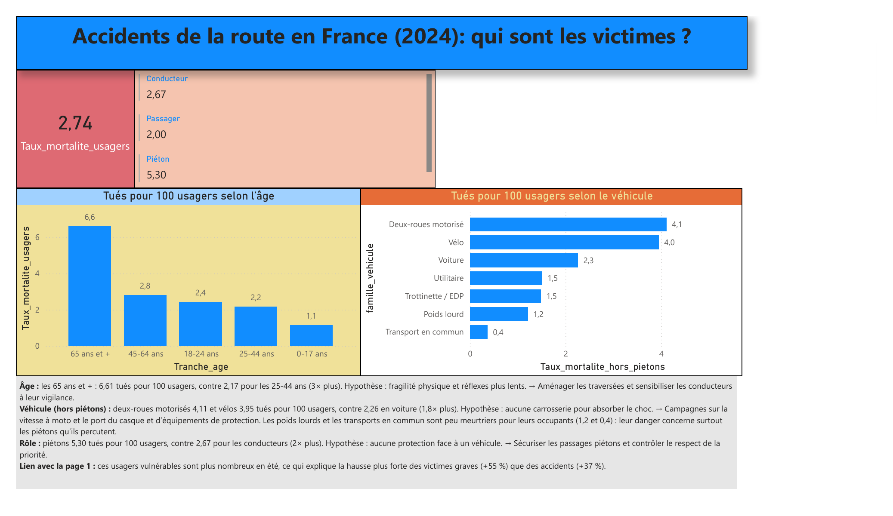

## Tableau de bord Power BI

Prolongement de l'analyse SQL : les mêmes données (accidents corporels 2024, data.gouv.fr) sont présentées dans un tableau de bord Power BI de 3 pages, pensé pour un responsable de la sécurité routière.

📄 [Voir le tableau de bord en PDF](dashboard_accidents_2024.pdf) · 📊 [Fichier Power BI (.pbix)](dashboard_accidents_2024.pbix)

> **Deux indicateurs de gravité** : les pages 1 et 2 utilisent le nombre de **tués pour 100 accidents** (moyenne : 6,31), adapté pour comparer des lieux et des conditions. La page 3 utilise les **tués pour 100 usagers impliqués** (moyenne : 2,74), le même indicateur que l'analyse SQL, adapté pour comparer des profils de victimes.

### Page 1 — Quand ?

- **54 402 accidents**, **22 558 victimes graves** et **3 432 tués** en 2024.
- **Saisonnalité** : de février à juillet, les accidents augmentent de 37,4 % et les victimes graves de 55,3 %. L'été cumule plus d'accidents et des accidents plus graves.
- **Semaine** : pics à 8h et à 17h–18h, liés aux trajets domicile-travail.
- **Week-end** : vers 1h du matin, environ deux fois plus d'accidents qu'en semaine.

### Page 2 — Où et dans quelles conditions ?

- **Météo** : 16,1 tués pour 100 accidents par brouillard (2,5× la moyenne) et 15,4 par vent fort.
- **Routes** : 11,39 hors agglomération contre 3,26 en agglomération (3,5×), et 15,16 sur les départementales hors agglomération.
- **Départements** : les plus mortels sont ruraux (Dordogne 21,71, Jura 21,21, Haute-Marne 19,44).

### Page 3 — Qui sont les victimes ?

- **Âge** : 6,61 tués pour 100 usagers chez les 65 ans et plus, contre 2,17 chez les 25-44 ans.
- **Véhicule (hors piétons)** : 4,11 en deux-roues motorisé et 3,95 à vélo, contre 2,26 en voiture. Les poids lourds et les transports en commun sont peu meurtriers pour leurs occupants : leur danger concerne surtout les piétons qu'ils percutent.
- **Rôle** : 5,30 pour les piétons, contre 2,67 pour les conducteurs.
- Ces usagers vulnérables sont plus nombreux en été, ce qui explique que les victimes graves augmentent plus vite que les accidents.

### Démarche technique

- **Import** : 4 tables exportées en CSV depuis MySQL (`caract`, `lieux_unique`, `usagers`, `vehicules`), en reprenant la table `lieux` dédoublonnée lors de l'analyse SQL.
- **Modèle** : relations par `num_acc` et `id_vehicule`, mesures DAX regroupées dans une table `_Mesures`.
- **Mesures DAX** : nombre d'accidents, de tués, de victimes graves et d'usagers, taux de mortalité par accident et par usager (`DIVIDE`), taux hors piétons (`CALCULATE`).
- **Colonnes calculées** : jour, heure, mois (avec colonnes de tri), tranches d'âge (`SWITCH(TRUE())`) identiques à celles de l'analyse SQL.
- **Carte** : table de correspondance des départements créée pour corriger le géocodage automatique (un département français était placé en Suisse).
- **Contrôle qualité** : tous les chiffres du tableau de bord ont été recoupés avec les résultats SQL. Ce recoupement a permis de corriger une mesure erronée et d'aligner le graphique des véhicules sur la définition SQL (piétons exclus, car ils sont rattachés au véhicule qui les a percutés).

### Outils

MySQL Workbench · Power BI Desktop · DAX
